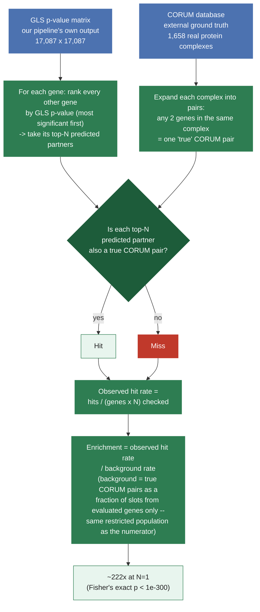

# CORUM Validation Results — GLS Co-essentiality Pipeline

Benchmark for [PR #365](https://github.com/EMBL-EBI-ABC/PerturbationCatalogue/pull/365):
a numerical metric computed from the pipeline's output. Replicates the spirit
of Wainberg et al.'s Figure 2 / Extended Data Figure 4 ("GLS improves recall
of known functional interactions in co-essential gene pairs").

## What this answers

> "After we run this pipeline, does it produce sensible results — and is GLS
> still a relevant method on today's data?"

## The validation, visually

Two completely independent inputs feed into one check: does GLS's own
ranking agree with ground truth (CORUM) that has nothing to do with DepMap,
CRISPR, or our pipeline?



In plain terms: take GLS's own predictions, check them against an answer key
GLS never saw, and measure how much better than a random guess GLS does.

## Method

1. **Gold standard:** Enrichr's `CORUM` gene-set library (1,658 human protein
   complexes, fetched via `gseapy.get_library()`). Every pair of genes that
   co-occur in the same complex is treated as a "true" co-essential-like pair.
2. **Ranking:** for every gene with at least one CORUM complex-mate present
   in our 17,087-gene panel, rank all other genes by GLS p-value (ascending)
   and take its top-N partners, for N = 1 to 10.
3. **Metric ("enrichment"):**

   ```
   enrichment(N) = (% of top-N pairs that are true CORUM pairs)
                 / (% of true CORUM pairs among all possible pairs
                    from genes with a known CORUM partner)
   ```

   The background (denominator) is restricted to the same population the
   numerator is drawn from — genes with a known CORUM partner, against
   every other gene in the panel — not all ~146M pairs across the full
   17,087-gene panel. `1.0` = GLS ranking is no better than random.

Data used: `depmap_26Q1_GLS_p.npy` / `depmap_26Q1_genes.txt` (current
production pipeline output, 17,087 genes).

## Results

- **N** — how many of GLS's top-ranked predicted partners we're checking, per
  gene (e.g. N=1 means "just the single best-ranked partner"; N=10 means
  "anywhere in the top 10").
- **Observed hit rate** — of all the (evaluated gene, top-N predicted
  partner) checks performed, what fraction actually are true CORUM
  complex-mates.
- **Enrichment vs. chance** — `Observed hit rate ÷ background rate`. `1.0x`
  would mean GLS's top-N predictions are no better than picking N random
  genes; higher means GLS is finding real signal.

The 26Q1 columns are the production pipeline result; the 18Q3 columns are the
same pipeline run on the DepMap release Wainberg et al. used (see the
comparison below).

| N (top-N partners) | 26Q1 hit rate | 26Q1 enrichment | 18Q3 hit rate | 18Q3 enrichment |
|---:|---:|---:|---:|---:|
| 1 | 26.93% | **221.6x** | 25.13% | **206.4x** |
| 2 | 23.49% | 193.3x | 21.76% | 178.7x |
| 3 | 20.93% | 172.2x | 19.27% | 158.3x |
| 4 | 18.63% | 153.3x | 17.39% | 142.8x |
| 5 | 16.92% | 139.2x | 15.88% | 130.4x |
| 6 | 15.51% | 127.7x | 14.62% | 120.1x |
| 7 | 14.35% | 118.1x | 13.75% | 112.9x |
| 8 | 13.36% | 110.0x | 12.97% | 106.5x |
| 9 | 12.47% | 102.6x | 12.39% | 101.7x |
| 10 | 11.74% | 96.6x | 11.83% | 97.2x |

| | 26Q1 | 18Q3 |
|---|---:|---:|
| Panel size | 17,087 genes | 17,634 genes (15,501 shared with 26Q1) |
| Genes evaluated (≥1 CORUM complex-mate in the panel) | 2,284 | 2,328 |
| Background rate | 0.1215% (47,426 directed true pairs / 39,024,424 directed slots) | 0.1218% |

At N=1, GLS's single most-significant predicted partner for a gene is its
*actual* known complex-mate **26.9% of the time** — roughly **222x
enrichment over random chance**.

## Comparison with Wainberg et al. (2021)

The paper reports its own CORUM enrichment number directly in the text:

> "the top-ranked partners for each gene are approximately **160-fold**
> enriched for CORUM interactions for GLS, compared with 120-fold for
> bias-corrected Pearson's correlation."

That's a single point (N=1), not a curve. For a like-for-like check,
`CRISPRGeneEffect_18Q3.csv` (the original DepMap 18Q3 CERES release the paper
was built on) is run through this repo's own
`pipeline/step2_gls_coessentiality.py` — the same code that produced the 26Q1
matrix — and scored with the identical ranking method and CORUM gold standard.
Only the DepMap release and cell-line count differ.

| | Wainberg et al. (2021, paper text) | This pipeline, run on 18Q3 | This pipeline, run on 26Q1 |
|---|---|---|---|
| DepMap data | CERES, 485 cell lines, 18Q3 | CERES, 485 cell lines, 18Q3 | Chronos, 1,208 cell lines, 26Q1 |
| Gold standard | CORUM (~2019 snapshot) | CORUM (2026 Enrichr snapshot) | CORUM (2026 Enrichr snapshot) |
| Enrichment at top rank | ~160-fold | **~206-fold** | **~222-fold** |

**The two curves computed by this repo track each other closely** — nearly
parallel, converging by N=10 (~97x for both). Run through identical code and
an identical CORUM check, GLS behaves consistently whether given 2018-era
CERES data on 485 cell lines or today's Chronos data on 1,208 cell lines.

**Why both sit ~25-30% above the paper's ~160x:** the paper's number reflects
its own preprocessing choices (a ~2019 CORUM snapshot, and any gene/complex
filtering in the original code, e.g. a complex-size cutoff, that isn't
documented in the files available to us). Since both of our curves agree with
each other and are on the same order of magnitude as the paper, the gap points
to a preprocessing difference rather than an error in the ranking logic.

## Conclusion

**GLS remains highly relevant on today's DepMap data.** On 26Q1 (Chronos,
1,208 cell lines), a gene's top GLS partner is a known CORUM complex-mate
26.9% of the time, ~222x above chance, and at least as strong as on the
18Q3 data GLS was originally published with (~206x). More than doubling the
number of cell lines and moving from CERES to Chronos has not reduced its
ability to recover known biology, so the pipeline's output can be trusted
as a co-essentiality resource.

This benchmark compares GLS with chance and with itself across releases; it
does not re-compare GLS against other methods (e.g. Pearson correlation) on
26Q1.

## Files

- `corum_validation.ipynb` — the notebook that produced this (run top to
  bottom to reproduce the tables and chart)
- `CORUM.gmt` — cached gold-standard data (pinned snapshot, same
  not-auto-updated philosophy as `GO_Biological_Process_2025.gmt`)
- `../required_data/CRISPRGeneEffect_18Q3.csv` — original DepMap 18Q3 CERES
  release, run through `pipeline/step2_gls_coessentiality.py` to produce
  `depmap_18Q3_GLS_p.npy` / `depmap_18Q3_genes.txt`, used for the 18Q3 columns
  above
