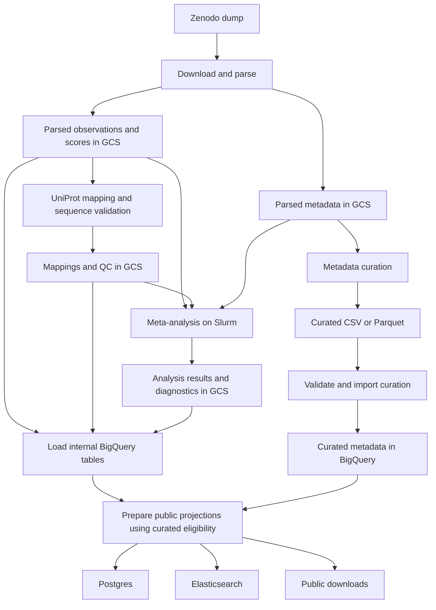

# MAVE pipeline implementation plan

Implement a modular Nextflow pipeline under `data_sources/mavedb/` that brings MaveDB parsing, UniProt mapping, quality assessment, meta-analysis, metadata curation import and portal publication into the Perturbation Catalogue (PC) repository.

Build a working pipeline on representative score sets first, then expand coverage and polish the interfaces. Defer the versioning system until the processing steps and outputs have settled. Initial development uses explicit input/output paths, ordinary configuration files and development cloud tables.

**Agreed requirements**

- Parsed source metadata lives in GCS and supplies the metadata curation workflow.
- Curated metadata lives in BigQuery and determines which entries are publicly visible.
- Only curated score sets appear in portal results, search summaries, counts or public downloads.
- Parsing, mapping and meta-analysis implementations become part of the PC repository. The running pipeline must use code maintained here.
- Preserve original variant accessions and HGVS strings, including complex or ambiguous perturbations.
- Unsupported parsing, ambiguous mapping, reference mismatch and unmapped records remain explicit QC outcomes. Retain variant details and aggregate relevant dataset metrics.
- Individual modules and useful combinations of modules can run independently from existing files in GCS or local storage.

**Storage and ownership**

| Product | Primary location | Purpose |
| --- | --- | --- |
| Original dump and extracted source files | GCS | Preserve the input needed to repeat parsing |
| Parsed source metadata | GCS, preferably Parquet with raw source JSON retained | Source material for curation and analysis context |
| Parsed observations and scores | GCS Parquet; internal BigQuery tables | Scientific input files and queryable observations |
| UniProt references and mapping outputs | GCS; internal BigQuery mapping tables | Reusable reference data and explicit mapping results |
| Variant and dataset QC | GCS; internal BigQuery QC tables | Diagnostics, coverage reports and analysis eligibility |
| Meta-analysis outputs | GCS; internal BigQuery result tables | Derived effects, uncertainty and model diagnostics |
| Curated metadata | BigQuery | Authoritative curated context and public eligibility |
| Portal data and search documents | Postgres and Elasticsearch, populated from BigQuery | Serving projections for curated entries |
| Public dataset downloads | Existing release storage, populated from curated BigQuery projections | The same curated population as the portal |

The initial implementation does not need a separate parsed-metadata table in BigQuery. Its authoritative parsed metadata files remain in GCS. Internal observation tables may carry identifiers needed for joins without duplicating the full source metadata.

**Proposed data flow**



Analysis modules should declare the inputs they actually use. Basic assay QC can operate on parsed data; analyses requiring canonical protein positions also consume mapping outputs. If analysis needs curated fields such as score interpretation, supply an explicit extract of those fields from BigQuery as another input.

**Nextflow modules and independent execution**

| Proposed workflow | Main inputs | Outputs |
| --- | --- | --- |
| `INGEST` | Zenodo file URL or existing dump, output directory | Parsed metadata, observations, scores and ingestion QC |
| `MAP` | Parsed files, UniProt reference files, mapping configuration | Target mappings, variant mappings and mapping QC |
| `LOAD_DATA` | Selected parsed, mapped, QC or analysis files | Internal BigQuery tables and load report |
| `ANALYSE` | Declared parsed/mapped inputs and analysis configuration | QC, normalized effects, optional combined effects and fit diagnostics |
| `IMPORT_CURATION` | Curated CSV/Parquet and source metadata identifiers | Validated curated metadata in BigQuery and import report |
| `PUBLISH` | Internal BigQuery products and curated metadata | Curated public projections, Postgres, Elasticsearch and downloads |

Provide a composed preparation workflow for ingestion, mapping and internal loading. Provide a full automated workflow that can consume an already available curated metadata file. Human curation remains an activity between runs; the automated workflow imports its completed output.

Each standalone workflow accepts explicit input paths. Running `MAP` against existing parsed files must not require downloading or parsing again. Importing a metadata correction must not require repeating mapping or fitting. Missing prerequisites should produce a clear error naming the required input.

Separate Nextflow orchestration from the implementation scripts. Keep transformations callable from a normal command line so they can be developed and checked on small files before they are wired into Nextflow.

**Repository layout and migration**

Suggested layout; exact filenames can evolve during implementation:

```text
data_sources/mavedb/
  README.md
  pipeline/
    main.nf
    nextflow.config
    conf/
    modules/
    subworkflows/
  parsing/
  mapping/
  analysis/
    R/
    stan/
  schemas/
  containers/
  tests/
    fixtures/
```

Bring the relevant extraction, identifier handling and residue validation logic from `protvar-mave-import` into `mapping/` and `parsing/`. Bring the required R/Stan methods, analysis entrypoints and supporting resources from `ot_perturbation_catalog_mave_experiments` into `analysis/`. Preserve required attribution and licences when transferring code.

Create a single shared parsing interface. Adapt mapping and analysis to consume its outputs so each workflow uses the same accession handling, HGVS representation and position conventions. Remove dependencies on sibling repository paths and scheduler-specific batch wrappers. Retain only the analysis methods and resources required by the selected scientific products; migrate additional experiments when they become relevant.

**Data contracts to establish first**

| Product | One row represents | Essential fields |
| --- | --- | --- |
| Source score-set metadata | One score set, with separately represented targets where needed | Score-set, experiment and experiment-set URNs; study references; target and assay context |
| Source observations | One original MaveDB variant record | Original accession, score-set URN, variant number, original nucleotide/protein/splice HGVS and parsing outcomes |
| Source scores | One named measurement for an observation | Accession, score name and raw value |
| Target mappings | One candidate target-to-reference mapping | Score-set URN, source target identity, UniProt accession/isoform, offset or alignment details and mapping status |
| Variant mappings | One candidate mapping for an observation and target | Accession, source target, reference identity, source position, mapped position, reference/alternate residue and validation outcomes |
| Derived effects | One declared analysis result at its stated grain | Source or derived identity, method, value, uncertainty where available and contribution links |
| Curated metadata | One curated score set in the first iteration | Score-set URN, curated experimental context and explicit public eligibility |

Keep full score-set URNs and original accessions throughout processing. Existing catalogue `dataset_id` fields can use the score-set URN; retain source identity when creating compatibility fields such as `sample_id`.

Select measurement columns explicitly instead of assuming every column after a fixed position is numeric. Preserve useful source annotations separately and report unfamiliar columns for review.

Use explicit names for target-sequence positions and UniProt positions. Preserve the original nucleotide coordinate type and its reference sequence. Canonical protein mapping must account for offsets exactly once. Genomic variant mapping is a separate extension requiring an assembly, transcript and allele contract.

**Parsing, mapping and QC behavior**

Keep parsing, mapping and sequence validation outcomes separate so a record can carry several issues. For example, an observation can have valid nucleotide parsing while its protein HGVS is unsupported, or have a candidate UniProt mapping whose reference residue does not match.

| Required outcome | Variant-level record | Dataset-level summary |
| --- | --- | --- |
| Unsupported parsing | Original HGVS, affected coordinate type and unsupported construct/reason | Counts and rates by coordinate type and variant class |
| Ambiguous mapping | Candidate references/positions and reason no unique mapping was chosen | Ambiguous observations and affected score sets/targets |
| Reference mismatch | Expected and observed reference symbol, reference sequence and checked position | Mismatch counts and rates among observations actually checked |
| Unmapped | Mapping attempted and reason no usable mapping was found | Counts and rates among eligible observations |

Also distinguish malformed input, missing required information, successful checks, checks that were not performed and checks that do not apply. Missing protein HGVS does not automatically make a nucleotide observation invalid.

Validate reference symbols against the source target sequence before checking mapped symbols against UniProt. Define coordinate indexing and permitted residue/nucleotide symbols in the schema and parser behavior. Never replace a source position with a mapped position in place.

Retain complex observations even when scalar position/ref/alt fields cannot represent them. Initially those fields can remain null with an explicit unsupported status. Candidate mappings belong in a separate relation so ambiguous mappings cannot silently multiply source score rows.

Variant QC should identify the observation, check, outcome and reason, with relevant reference details. Dataset QC should include total observations, parseable observations, mapping outcomes, reference checks and metric denominators. Counts for different checks may overlap and must not be presented as mutually exclusive categories unless defined that way.

Mapping or parsing issues do not automatically remove a curated dataset or its observations. Preserve raw HGVS, expose the applicable QC status, and leave unsupported mapped fields null. Analyses that require a particular representation should select eligible observations explicitly and report excluded counts and reasons.

Structural contract failures such as missing required columns or duplicate observation identities should stop the affected stage. Expected record-level limitations should produce QC outcomes and retained source records.

**Meta-analysis execution**

Implement basic score-set QC first, then per-assay normalization and model diagnostics. Define the intended cross-study combined-effect product separately: its grouping rules, comparability assumptions and contributing observations must be explicit before public use.

Run analysis scripts inside Nextflow tasks submitted through the Slurm executor. Use containers or an explicitly defined reproducible environment for R, Stan and supporting tools. Start with score-set-level tasks; group-level aggregation follows the applicable assay tasks. Resource settings should account for large differences in observation counts.

Stage selected GCS inputs to cluster storage for reuse across tasks. Write analysis products and diagnostics to GCS, then let `LOAD_DATA` load the selected products into BigQuery. Analysis tasks should not write directly to Postgres or Elasticsearch.

Keep raw scores, normalized effects, aggregated effects and fit diagnostics distinct. Preserve links between derived substitutions and the original observations that contributed to them. Record insufficient-data, convergence or method-eligibility failures as analysis QC with reasons. Training-data filters from the existing analysis repository require review before becoming rules for catalogue analyses.

**Curation import and public eligibility**

Supply curators with parsed metadata from GCS, retaining the score-set identifiers. Accept a curated CSV or Parquet file and validate required fields, identifiers, ontology field pairs and duplicate score sets before importing it into BigQuery.

For the first iteration, use one canonical eligibility field such as boolean `is_curated`. Normalize existing file values such as `Yes` during import. Missing metadata rows and rows without an explicit curated state are ineligible for publication. Validating the file must not automatically mark every row as curated.

Keep curated values separate from parsed source metadata. Import behavior must support correcting fields, deliberately clearing fields and removing public eligibility. Make replacement versus partial-update behavior explicit, including how rows absent from a replacement file are handled.

Description or ontology corrections should permit curation import and republication alone. Changes to analysis-relevant fields, such as score direction or target identity, should identify the analyses requiring reruns.

**BigQuery loading and publication**

Use internal BigQuery tables for observations, named scores, mappings, variant QC, dataset QC and derived results. Curated metadata has its own authoritative table. Declare each table's complete key: a score table needs the measurement name in addition to observation identity. Make repeat loads replace or merge the intended development scope without appending duplicates.

Prepare public models by joining internal data to eligible curated score sets. These models are the common input for Postgres, Elasticsearch and downloadable files. Existing `mavedb.data` and `mavedb.metadata` contracts can become compatible curated projections if that is the least disruptive integration with the warehouse.

Update the warehouse projection and release code to consume the prepared position/ref/alt fields. Parse HGVS once upstream. Review the corresponding Postgres schema, API fields and downloadable columns together.

Reuse the existing warehouse loading implementations through a MAVE-specific publication entrypoint. All public paths must enforce the same curated population: dataset search, direct dataset searches, target summaries, counts, filtered downloads and complete dataset exports.

When a previously public score set loses curated eligibility, remove its serving rows and search documents and withdraw or block its old downloads. Publication must reconcile removals as well as additions and updates. Parsed or analyzed data being present internally never grants public eligibility.

**Implementation sequence and completion criteria**

| Phase | Work | Completion criterion |
| --- | --- | --- |
| 1. Contracts and fixtures | Define initial tables, coordinate conventions, QC outcomes and representative inputs | Fixtures cover simple substitutions, nonzero offsets, complex HGVS, ambiguity, mismatches, unmapped targets and multiple score columns |
| 2. Ingestion | Implement dump download/reuse, metadata extraction, observation parsing and named scores | Original identifiers/HGVS survive; parsed metadata and data are written to GCS with a useful ingestion report |
| 3. Mapping and QC | Migrate mapping logic and implement source/UniProt sequence checks | Candidate mappings are explicit; required QC outcomes exist at variant and dataset levels |
| 4. Internal loading | Load observations, scores, mappings and QC into development BigQuery tables | Repeated loads are safe; source and loaded row counts reconcile; no public visibility is introduced |
| 5. Curation and publication | Import a small curated file and connect the curated projections to serving stores and downloads | Curated entries are discoverable; uncurated entries are inaccessible through every public path; withdrawal also works |
| 6. Analysis | Migrate required R/Stan code, adapt inputs and execute through Slurm | Analysis consumes shared cloud inputs and produces loadable outputs with diagnostics and lineage |
| 7. Broader runs and polish | Expand source coverage, check resource use and document independent commands | Individual modules and composed workflows run against existing inputs with clear prerequisite checks |

Use focused checks for biological parsing/mapping and visibility enforcement, plus a small end-to-end fixture. Verify that multiple nucleotide observations contributing to one protein substitution remain traceable, and that ambiguous mappings do not inflate score counts. Check that dataset QC totals reconcile with retained observations and documented exclusions.

After the pipeline is useful and its contracts are stable, revisit versioning, incremental processing and more elaborate release coordination using the behavior observed during development.

**Existing integration points**

- [MAVE source directory](/Users/zakirov/Documents/GitHub/PerturbationCatalogue/data_sources/mavedb/README.md).
- [Current MAVE curation helpers](/Users/zakirov/Documents/GitHub/PerturbationCatalogue/data_exploration/curation_tools/mavedb_curation_tools.py).
- [Warehouse orchestration](/Users/zakirov/Documents/GitHub/PerturbationCatalogue/dwh/cloudbuild.yaml).
- [Postgres projections](/Users/zakirov/Documents/GitHub/PerturbationCatalogue/dwh/bq_to_postgres/bq_to_postgres.py).
- [Release projections](/Users/zakirov/Documents/GitHub/PerturbationCatalogue/dwh/release/release.py).
- [Portal query implementation](/Users/zakirov/Documents/GitHub/PerturbationCatalogue/be/data_query.py).
- [Existing MAVE architecture diagram](/Users/zakirov/Documents/GitHub/PerturbationCatalogue/development_docs/mavedb-pipeline-architecture.mmd). Align it with this plan when updating the architecture documentation, including keeping parsed metadata in GCS.
